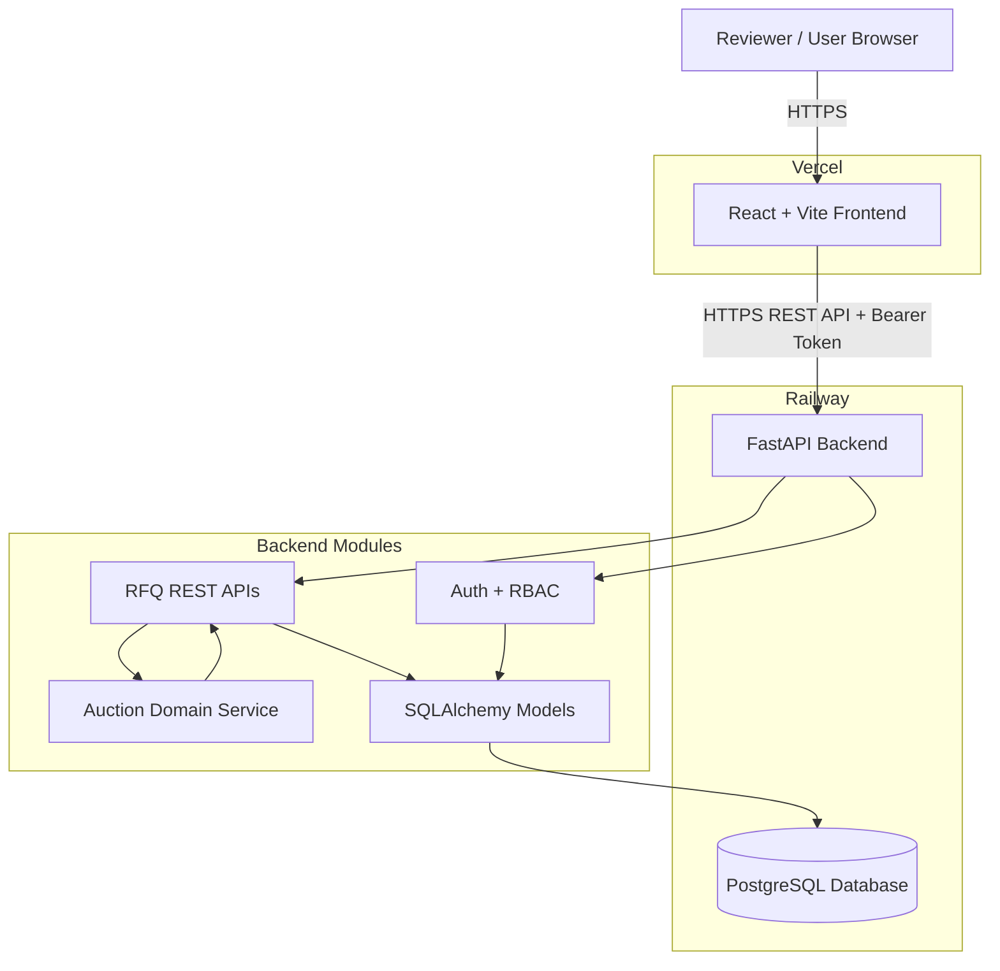
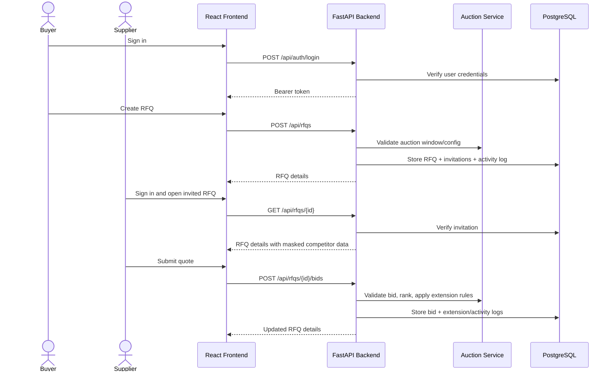

# Architecture Diagram

## Request Flow

## Component Responsibilities

| Component | Responsibility |
| --- | --- |
| React Frontend | User interaction, forms, RFQ listing, details, ranking display |
| FastAPI Backend | API routing, validation, auth, RBAC, persistence |
| Auction Service | Business rules for ranking, rebids, status, and extension logic |
| PostgreSQL | Durable storage for users, RFQs, invitations, bids, and logs |
| Railway | Backend and database hosting |
| Vercel | Frontend hosting |
