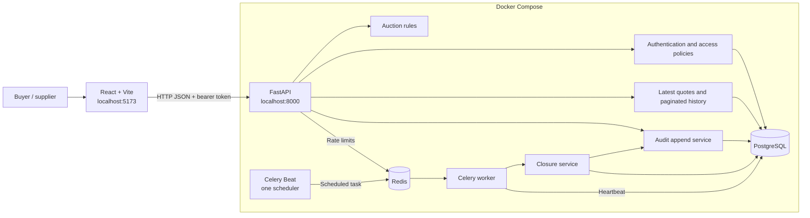
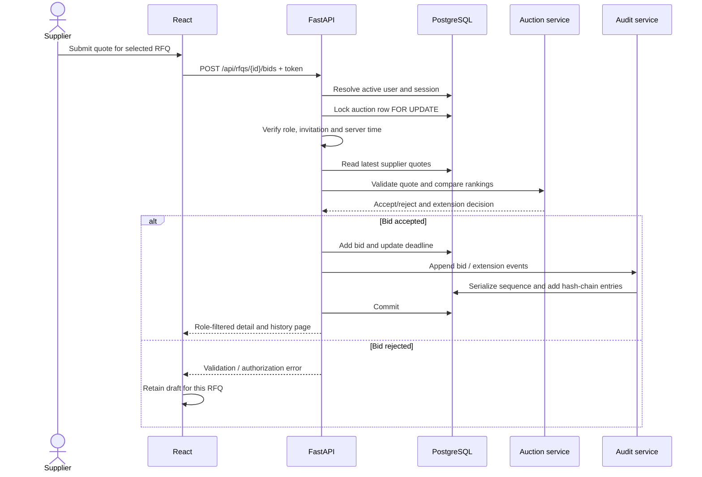
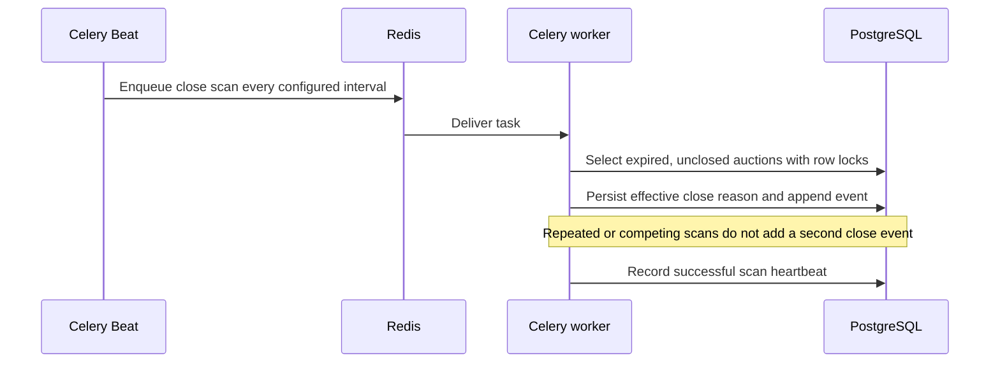

# Architecture and Request Flow

The hosted demo was retired on **21 November 2026**. These diagrams describe the current local setup. See the [README](../README.md) for commands and the [deployment record](deployment-status.md) for hosting status.

## Component diagram

The backend boxes are modules in one Python application, not separately deployed microservices. Route handlers coordinate transactions; the auction service calculates rules without owning HTTP or database connections.

## Bid transaction

Acquiring the row lock before reading the current bidding state ensures that concurrent requests evaluate the preceding committed extension. A failed transaction rolls back its writes. Monetary values use Decimal/Numeric instead of binary floating-point arithmetic.

## Scheduled closure

Each run processes up to 50 batches of 100 auctions. Request-time deadline validation remains authoritative even if the worker is delayed. A stale or missing heartbeat produces 503 from the buyer-only operations endpoint.

## Boundaries and recovery

| Concern | Design |
| --- | --- |
| Supplier isolation | Account IDs, invitations and buyer ownership are checked on the backend. |
| Read growth | SQL window query selects latest supplier quotes; bid/activity histories are paginated. |
| Browser races | Session generations, cancellation and request ordering prevent stale writes; drafts are keyed by RFQ. |
| Database recovery | Connection pre-ping, timeouts and serialized migrations; readiness checks the database. |
| Request protection | Redis counters with TTLs; body size/time bounds; explicit trusted proxy ranges. |
| Audit history | Hash chaining plus database mutation guards; privileged administrators remain outside this trust boundary. |
| Process recovery | Compose separates API/worker/Beat. Optional combined supervisor mode exits if a web or worker child dies. |

## Historical hosted topology

The retired Vercel frontend called a Railway API. Railway also held PostgreSQL and Redis. Due to the demo plan's service limit, the API container supervised the web process and a combined Celery worker/Beat process with one replica. That arrangement must not be scaled to multiple web replicas while each replica starts a scheduler.

The local Compose setup uses separate services and exactly one Beat scheduler. GitHub Actions runs verification only; it has no deployment step.
