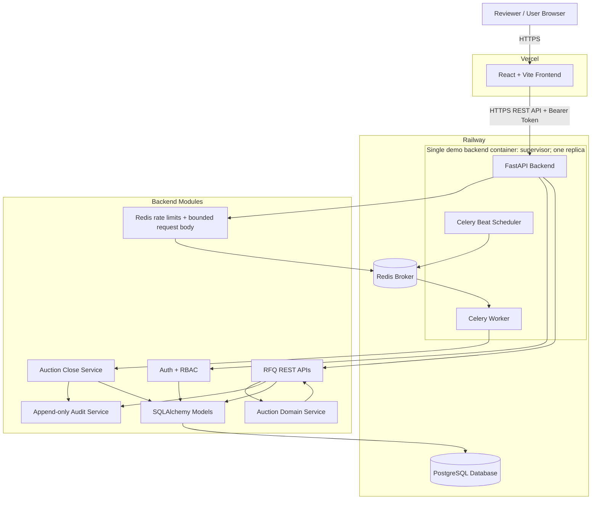
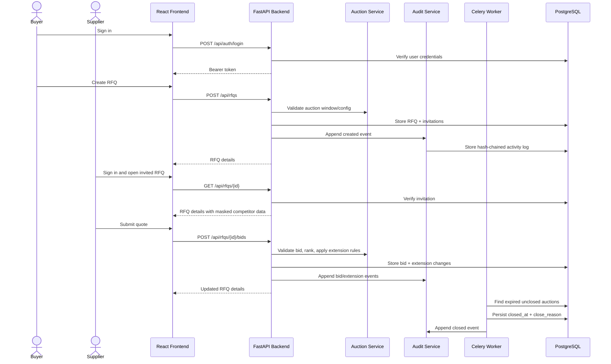

# Architecture Diagram

The diagram shows the actual demo deployment. Web and Celery processes share a supervised container because of the hosting plan limit. A child failure ends the container so Railway can restart it. `/ready` checks PostgreSQL; the authenticated operations endpoint checks worker freshness. For production, split the web, worker and single Beat scheduler into independent services.

## Request Flow

## Component Responsibilities

| Component | Responsibility |
| --- | --- |
| React Frontend | User interaction, forms, RFQ listing, details, ranking display |
| FastAPI Backend | API routing, validation, auth, RBAC, persistence, request safeguards |
| Auction Service | Business rules for ranking, rebids, status, and extension logic |
| Audit Service | Append-only activity logging with sequence and hash-chain verification |
| Celery Worker + Beat | Scheduled auction close transitions |
| PostgreSQL | Durable storage for users, RFQs, invitations, bids, and logs |
| Redis | Broker/result backend for Celery jobs |
| GitHub Actions | Migration check, backend tests, frontend build |
| Railway | Backend and database hosting |
| Vercel | Frontend hosting |
