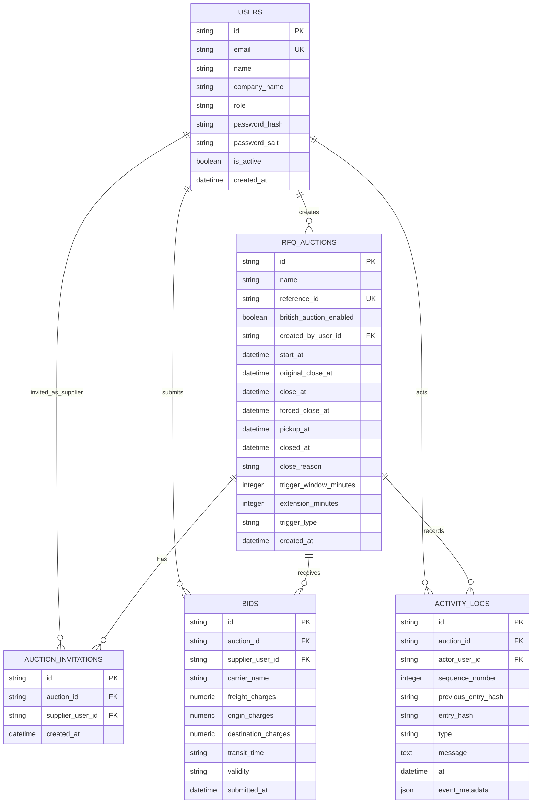

# Database Schema Design

## Entity Relationship Overview



## Tables

### users

Stores buyer and supplier users.

| Column | Type | Constraints | Description |
| --- | --- | --- | --- |
| id | string(36) | PK | UUID user ID |
| email | string(320) | unique, indexed, not null | Login email |
| name | string(120) | not null | User display name |
| company_name | string(160) | not null | Buyer/supplier company |
| role | string(20) | indexed, not null | `buyer` or `supplier` |
| password_hash | string(128) | not null | PBKDF2 password hash |
| password_salt | string(64) | not null | Per-user salt |
| is_active | boolean | not null | Account status |
| created_at | datetime | not null | Creation time |

### rfq_auctions

Stores RFQ auction configuration and current close state.

| Column | Type | Constraints | Description |
| --- | --- | --- | --- |
| id | string(36) | PK | UUID auction ID |
| name | string(160) | not null | RFQ name |
| reference_id | string(80) | unique, indexed, not null | RFQ reference ID |
| british_auction_enabled | boolean | not null | Auction flag |
| created_by_user_id | string(36) | FK users.id, indexed, not null | Buyer who created RFQ |
| start_at | datetime | not null | Bid start time |
| original_close_at | datetime | not null | Original bid close time |
| close_at | datetime | not null | Current bid close time |
| forced_close_at | datetime | not null | Hard close limit |
| pickup_at | datetime | not null | Pickup/service date |
| closed_at | datetime | nullable, indexed | Persisted close transition time set by scheduled worker |
| close_reason | string(40) | nullable | `scheduled-close` or `forced-close` |
| trigger_window_minutes | integer | not null | X-minute trigger window |
| extension_minutes | integer | not null | Y-minute extension duration |
| trigger_type | string(40) | not null | `bid-received`, `any-rank-change`, or `l1-rank-change` |
| created_at | datetime | not null | Creation time |

### auction_invitations

Stores supplier access to RFQs.

| Column | Type | Constraints | Description |
| --- | --- | --- | --- |
| id | string(36) | PK | UUID invitation ID |
| auction_id | string(36) | FK rfq_auctions.id, indexed, not null | Auction ID |
| supplier_user_id | string(36) | FK users.id, indexed, not null | Invited supplier user |
| created_at | datetime | not null | Invitation time |

Unique constraint:

```text
(auction_id, supplier_user_id)
```

### bids

Stores supplier quote submissions.

| Column | Type | Constraints | Description |
| --- | --- | --- | --- |
| id | string(36) | PK | UUID bid ID |
| auction_id | string(36) | FK rfq_auctions.id, indexed, not null | Auction ID |
| supplier_user_id | string(36) | FK users.id, indexed, not null | Supplier user |
| carrier_name | string(160) | not null | Carrier/company name from authenticated supplier |
| freight_charges | numeric(12,2) | not null | Freight charge |
| origin_charges | numeric(12,2) | not null | Origin charge |
| destination_charges | numeric(12,2) | not null | Destination charge |
| transit_time | string(80) | not null | Transit time |
| validity | string(80) | not null | Quote validity |
| submitted_at | datetime | indexed, not null | Server-owned submission time |

Index:

```text
(auction_id, supplier_user_id, submitted_at)
```

### activity_logs

Stores audit/activity events for RFQs.

| Column | Type | Constraints | Description |
| --- | --- | --- | --- |
| id | string(36) | PK | UUID log ID |
| auction_id | string(36) | FK rfq_auctions.id, indexed, not null | Auction ID |
| actor_user_id | string(36) | FK users.id, indexed, nullable | Acting user |
| sequence_number | integer | indexed with auction_id, nullable for legacy rows | Per-auction append sequence |
| previous_entry_hash | string(64) | nullable | Previous log hash in the auction audit chain |
| entry_hash | string(64) | indexed, nullable for legacy rows | SHA-256 hash of the canonical log payload |
| type | string(40) | not null | Event type: `created`, `bid`, `extension`, `closed` |
| message | text | not null | Human-readable event message |
| at | datetime | not null | Event time |
| event_metadata | json | nullable | Structured metadata |

## Design Notes

- Money fields use `NUMERIC(12,2)` instead of float to avoid rounding issues.
- Supplier access is controlled through `auction_invitations`.
- RFQ reference IDs are unique.
- Each supplier can submit multiple bids, but only their latest valid bid is used for current ranking.
- Activity logs are append-only in the application layer and chained with hashes so changed or reordered logs are detectable.
- Scheduled close workers update `closed_at`/`close_reason` once and append a `closed` audit event.
